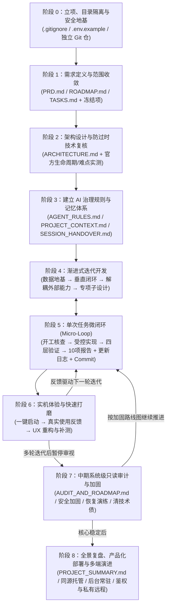
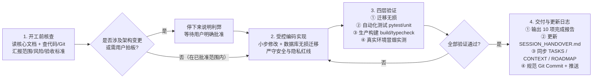

# 通用 AI 辅助程序开发全流程手册（AI-Native Software Engineering Playbook）

> **文档定位：** 这是一份**与具体项目无关、可复用到任何软件开发项目**的通用工程 SOP（标准作业程序）。它完整沉淀了“人类产品负责人（Product Owner）+ AI Coding Agent”从 0 到 1、再从原型演进到长期稳定运行的全过程，涵盖需求文档、架构复核、治理规则、单次任务闭环、每次更新交接日志、安全加固、中期审计与产品化演进。

---

## 一、核心协作理念与最高原则

在正式写代码之前，必须先确立人机协作的底层秩序：

### 1. 角色分工
- **你（Product Owner / 最终决策者）：** 负责提出真实场景、明确目标与边界、审批架构与范围、做实机体验反馈、拍板关键取舍，**不需要懂每一行代码细节**，但必须始终掌控全局状态与风险。
- **AI Agent（全栈工程师 / 架构师 / 测试与文档维护者）：** 负责需求结构化、技术选型核实、编码实现、数据库迁移、自动化测试、实机冒烟验证，以及**持续维护项目文档与每次对话的更新日志**，保证高度透明。

### 2. 开发优先级铁律
无论开发什么类型的程序，所有取舍均遵循同一排序：
```text
Reliability（可靠性） > Data Integrity（数据完整性） > Core Functionality（核心功能） > Automation（自动化） > Visual Polish（视觉打磨）
```

### 3. 五条不可妥协的工程底线
1. **代码与实测为唯一真相（Source of Truth）：** 绝不凭旧文档臆断现状；绝不把“写了界面”或“有占位函数”当成“功能已完成”。
2. **严禁伪造数据（No Fake Data）：** 未接入的外部服务或后端接口，必须在界面和日志中明确标注「未连接 / 预览中」，不得用写死假数据冒充真实运行结果。
3. **人工确认闭环（Human-in-the-Loop）：** 凡涉及发外部消息、删除重要数据、覆盖用户已确认记录、修改外部系统状态等不可逆或高影响写操作，必须经过人工确认并写入审计日志。
4. **隐私与凭据零泄露：** 密钥、Token、真实个人数据库与备份文件永久排除在版本库之外；敏感隐私模块在架构层与外部服务硬隔离。
5. **小步快跑，每步必验：** 不一次性堆砌几千行未测试代码；按模块拆解，每次改动必须跑通迁移、自动化测试与构建验证后再提交。

---

## 二、开发全生命周期鸟瞰图



---

## 三、核心文档体系（让 AI 跨会话永不失忆的“外部大脑”）

大型或长期项目往往跨越几十次对话。为了避免每次新开对话 AI 遗忘上下文、推翻架构或虚报进度，项目根目录需维护一套**权责清晰、各司其职的 Markdown 文档体系**：

| 文档名 | 角色与权威定位（Source of Truth） | 何时创建 | 何时更新 |
| :--- | :--- | :--- | :--- |
| **`AGENT_RULES.md`** | **最高治理宪法**：规定 AI 开工前必做步骤、执行红线、10 项完成报告、日志更新规范与沟通方式 | 项目启动或治理升级时 | 用户修订协作规范时 |
| **`PRD.md`** | **产品需求真相源**：愿景、用户场景、全部功能模块、业务规则、数据实体、安全红线 | 阶段 1（需求定义） | 产品范围或核心业务规则变更时 |
| **`ARCHITECTURE.md`** | **技术架构真相源**：技术栈实测状态、系统分层图、关键难点方案、核心表设计、环境安装清单 | 阶段 1–2（架构复核） | 架构调整、新增核心表或新组件时 |
| **`ROADMAP.md`** | **宏观路线图与验收标准**：大阶段划分（MVP / 增强 / 扩展）及每个模块的**可执行验收标准** | 阶段 1–2 | 阶段切换或路线图重构时 |
| **`TASKS.md`** | **当前迭代任务清单**：严格按依赖排序的勾选清单（Checklist）+ **明确冻结项**（当前严禁开发的内容） | 阶段 2–3 | **每次推进或完成开发任务时** |
| **`PROJECT_CONTEXT.md`** | **长期项目上下文档案**：背景、真实进度、**已讨论但放弃的方案及原因**、重要产品/技术决策日志 | 阶段 1–3 | 每完成一个里程碑或做出重大决策时 |
| **`SESSION_HANDOVER.md`** | **跨会话交接与更新日志（最高频）**：按时间倒序记录每次重要对话的目标、实际工作、改动文件、验证结果、未决问题与**下次精确起点** | 阶段 3 | **每一次实质性开发或对话结束时强制更新** |
| **`<SUBSYSTEM>_DESIGN.md`** | **复杂子系统专项设计稿**（按需）：针对高复杂度模块先写架构、表结构、接口、外部源实测与验收标准 | 开发大型新模块前 | 经用户审批后冻结，落地后对照核验 |
| **`AUDIT_AND_ROADMAP.md`** | **中期系统级只读审计报告**（按需）：逐项核对代码与数据库真相，输出完成度矩阵、安全风险、技术债与重构路线 | 多轮迭代后进入稳定期前 | 每次全面体检时生成或更新 |
| **`PROJECT_SUMMARY.md`** | **独立全景总结文档**（按需）：脱离代码运行、无隐私脱敏的复盘文档，用于归档阅读与演进决策 | 重大阶段完成后 | 里程碑大版本节点 |

> **冲突裁决规则：** 当文档与代码不一致时，**运行中的真实代码和实测结果**是“实现现状”的唯一真相；`PRD.md` 是“批准需求”的真相；`ARCHITECTURE.md` 是“批准架构”的真相。AI 发现冲突必须先指出并向你确认，严禁静默假设。

---

## 四、通用开发全过程（8 大阶段详述）

### 阶段 0：项目立项、目录隔离与安全地基
1. **建立独立工作区与独立 Git 仓库：**
   - 永远为程序建立专属子目录和独立 `.git` 仓库，**绝对不要**在存有个人生活文件、证件或混合资料的上级目录初始化 Git。
2. **先写安全优先的 `.gitignore` 与 `.env.example`：**
   - `.gitignore` 第一时间屏蔽：`.env`、`*.key`、`*.pem`、OAuth 凭据/Token 目录、本地数据库与备份目录（`data/`、`*.db`、`*.sqlite*`）、构建产物、依赖目录（`.venv/`、`node_modules/`）、日志与系统垃圾文件（`.DS_Store`）。
   - 用 `git check-ignore -v .env data/app.db` 实测确认敏感文件绝不会被误提交。
   - `.env.example` 只放配置项键名与安全默认值，绝不填真实密钥。
3. **本机开发环境盘点：**
   - 让 AI 实测本机已安装工具及真实版本（OS、包管理器、语言运行时、数据库版本、Git），明确使用项目独立虚拟环境（如 `.venv`），避免污染全局系统环境。

---

### 阶段 1：需求定义与范围收敛（写任务需求）
1. **先聊清楚愿景与真实使用场景，再生成 `PRD.md`：**
   - 把你的真实高频使用场景、目标设备形态、主语言、核心闭环（例如：`采集 → 分析 → 沉淀 → 决策 → 执行 → 追踪`）和隐私边界全部告诉 AI，让其整理成结构化 `PRD.md`。
2. **用 `ROADMAP.md` 收束范围，避免一开始摊子铺太大：**
   - 将宏大愿景收敛为清晰的 **3 个演进层级**：
     - **Stage 1（MVP 最小可用闭环）**：跑通最核心的数据读写与核心价值，立即可日常使用。
     - **Stage 2（核心生态与工作流增强）**：接入外部账号/第三方 API、补齐高频联动模块。
     - **Stage 3（自动化、高级扩展与多端访问）**：定时任务、知识图谱、移动端/远程访问等，明确延后。
   - 每个交付模块必须附带**可执行的验收标准**（具体到点击什么、刷新后看到什么、运行哪条测试命令、返回什么结果）。
3. **拆解 `TASKS.md` 并设立「明确冻结项」：**
   - 把当前阶段拆成按严格依赖排序的 Step 1 / Step 2 / Step 3……
   - 单独列出一节 **「明确冻结项（当前阶段禁止开发）」**：明确哪些表不建、哪些依赖不装、哪些功能先不做，防止 AI 在写代码时“好心办坏事”过度扩张。

---

### 阶段 2：架构设计与“防过时”技术复核
在进入大规模编码前，必须让 AI 完成 `ARCHITECTURE.md` 并执行一次**严谨的技术复核**：
1. **明确职责分层与数据边界：**
   - 展示层（前端）、业务与权限层（后端）、持久化层（数据库）、外部智能/服务抽象层（Provider / Integration）严格解耦，绘制 Mermaid 系统架构图。
2. **核实技术栈真实生命周期（防 AI 幻觉与过时知识）：**
   - 核查运行时（Node.js / Python 等）的官方 LTS / EOL 状态，避免刚立项就用即将停服的旧版本。
   - 核查第三方 SDK 是否已切换新官方包、模型 ID 是否已弃用——**严禁在业务代码里硬编码模型名或密钥**，一律走 `.env` 配置并在接入时调用官方列表接口实测可用性。
3. **提前实测关键技术盲区：**
   - 对高风险技术假设做最小化真实实验（例如：中文全文检索对 2 字词是否失效、目标网站是否真有 RSS、本地端口与未来移动访问的网络架构是否冲突），用实测结论替代口头拍脑袋。
4. **务实数据库策略与最小初始表设计：**
   - 选择匹配规模的长期一等公民数据库（如单人/轻量应用用 SQLite + WAL 模式 + 外键约束），不盲目承诺不切实际的跨引擎迁移。
   - 引入规范的 Schema 迁移工具（如 Alembic / Prisma Migrate），**严禁通过删库重建迭代数据表**。
   - **最小初始表原则**：第一阶段只建 MVP 必需的最小核心表集合，严禁一口气建几十张空表。
5. **环境安装清单二分法：**
   - 严格区分 **「本机已有」**、**「本阶段现在必须装」**、**「明确未来才装（现在不要装）」**。

---

### 阶段 3：建立 AI 协作治理规范与记忆机制（关键转折点）
这一步决定了你的项目是“写两天就乱成一锅粥的玩具”，还是“能持续演进几个月以上的严肃工程”：
1. **创建 `AGENT_RULES.md`（给 AI 戴上“紧箍咒”）：**
   - 规定 AI **开工前 6 步必须检查文档与真实代码/Git**；
   - 规定 AI **执行期 6 条红线**（不擅改底层架构、不删用户数据、不无故替换可用实现、不静默引入付费服务、不泄露凭据、不做不可逆操作）；
   - 规定 AI **完工后必须提交 10 项标准化完成报告**；
   - 规定 AI **汇报时必须使用非技术通俗语言**，讲清技术概念的 4 个问题（它是什么、为什么重要、需不需要你拍板、不处理会怎样）；
   - 规定 AI **严格区分 5 种状态**：`已完成并验证 (Completed)`、`已实现待人工验证 (Implemented but unverified)`、`进行中 (In progress)`、`已规划 (Planned)`、`阻塞 (Blocked)`。
2. **创建 `PROJECT_CONTEXT.md`（记录“为什么这样做”与“为什么不做”）：**
   - 除了记录现状，特别保留一张 **「已讨论但放弃/延后的方案及原因」** 表和 **「重要讨论与决策日志」**，避免未来新会话里的 AI 反复建议你早已否决的方案。
3. **启用 `SESSION_HANDOVER.md`（每次回答/开发结束的更新日志）：**
   - 每次有实质性改动或重要讨论结束，AI 必须按固定格式在文件顶部追加本次会话日志。
   - **铁律：严禁覆盖或静默删除前序会话中尚未解决的历史风险和未决问题**，直到该问题真正解决并记录解决方式为止。

---

### 阶段 4：渐进式迭代开发策略
实际写代码时，遵循以下经过验证的高效顺序与架构套路：
1. **先打通地基与最小垂直闭环：**
   - 先做健康检查、数据库配置（如 WAL + 外键）、迁移链初始化、核心表 CRUD 和基础检索，跑通第一批自动化测试。
2. **界面优先消除占位，但诚实标注连接状态：**
   - 当你需要直观感受整体产品形态时，可以先将各模块完整交互界面补齐、统一视觉风格，但**必须把已接后端与纯前端预览清晰区分**，绝不冒充已持久化。
3. **抽象解耦外部依赖（防供应商锁定）：**
   - 对 AI 模型、外部数据源、通知/同步服务统一定义抽象协议接口（如 `AIProvider`、`BaseCollector`）。当某家 API 遇到额度耗尽、限流或涨价时，只需新增一个兼容实现类并改 `.env`，业务代码与前端零破坏。
4. **极致成本控制与可观测策略（尤其涉及 AI/付费 API 时）：**
   - **能用 0-Cost 本地规则/代码解决的，绝不调 AI**（如格式解析、关键词初筛、时间冲突检测、去重、定时提醒）。
   - 必须调用外部 AI 时：做**批量打包请求**、**输入长度截断**、**结果永久落库缓存（二次查看 0 成本）**、**按需手动触发**，并记录每次调用的耗时、Token 与预估花费，在设置页可视化展示。
5. **复杂子系统先写设计文档再写代码：**
   - 遇到多表、多采集源、多端联动或复杂安全逻辑的模块，先让 AI 产出独立的 `<SUBSYSTEM>_DESIGN.md`（含架构图、表字段、外部源实测报告、REST API 清单、验收标准）。**你审批通过后，AI 才能建表写代码。**

---

### 阶段 5：每次任务与每次对话的标准微闭环（Micro-Loop）

这是你在日常写程序时，**每一轮向 AI 提需求、AI 回答并落地代码时反复执行的标准循环**：



#### 第 1 步：开工前核查与对齐
每次开启新任务，AI 必须先：
1. 读取 `AGENT_RULES.md`、`PROJECT_CONTEXT.md`、`PRD.md`、`ARCHITECTURE.md`、`TASKS.md`、`SESSION_HANDOVER.md`；
2. 检查真实代码目录、`git status`、`git log`；
3. 向你简明说明：**本次任务范围、预计改动文件、潜在风险、验收标准、以及需要你决定的事项**。

#### 第 2 步：受控编码与遇到阻塞的正确处理
- 数据库表结构变动一律走**版本化无损迁移**，保留已有数据。
- 遇到外部阻塞（例如第三方账号欠费、网络超时、缺少 OAuth 凭据、权限不足）时：
  - **立即如实报告具体错误码与原因**，不掩盖、不造假；
  - 把该项标记为 `Blocked`，同时给出可选的替代方案或可并行的下一步本地任务。

#### 第 3 步：四层验证缺一不可
完成编码后，必须按顺序执行验证并记录真实结果（耗时、通过数、实测数据）：
1. **迁移验证：** 在真实或镜像库上执行升级脚本，确认零报错且历史数据零丢失。
2. **自动化测试：** 为新功能、隐私隔离红线、防重复幂等性、人工确认链路补充专项单测/集成测试，运行全套测试套件确认 0 回归。
3. **类型检查与生产构建：** 运行前端/后端编译与打包命令（如 `tsc && build`），确保 0 警告/0 报错。
4. **真实冒烟测试：** 对新增的联网采集、API 连通、备份恢复、文件生成等执行真实运行校验（绝不把纯 Mock 单测当成真实线上可用）。

#### 第 4 步：收尾交付、强制更新日志与 Git 提交
1. **向你输出标准 10 项任务完成报告**（见下文模板 C）。
2. **强制更新 `SESSION_HANDOVER.md`**：记录日期、目标、起点状态、实际工作、改动文件、验证结果、当前 5 类状态、**保留所有未解决的历史风险**、待决策事项，以及**下次对话的精确起步点**。
3. **同步勾销 `TASKS.md`**，如有里程碑或架构/决策变化同步更新 `PROJECT_CONTEXT.md` 与 `ROADMAP.md`。
4. **提交清晰的语义化 Git Commit**（如 `feat(module): ...` / `fix(ui): ...` / `docs: ...` / `chore: ...`），并定期推送到**私有远程仓库**做好异地代码备份。

---

### 阶段 6：实机体验、问题反馈与快速打磨循环
自动化测试通过 ≠ 真正好用。每完成一两个核心阶段，必须进入“你亲自上手用 → 提真实痛点 → AI 精准打磨”的循环：
1. **降低自测门槛：** 让 AI 编写一键启动脚本（`scripts/start.sh`）甚至双击启动器（如 macOS `.command`），支持自动拉起服务、打开浏览器和优雅退出清理进程。
2. **高频打磨方向：**
   - **消除盲操作与手打路径：** 用可视化清单替代凭感觉的滑块，用原生选择器/拖拽区替代手填绝对路径。
   - **防崩与防误点：** 加上全局 `ErrorBoundary` 防止单页报错导致整站白屏；关键按钮做**幂等防连点重复**、即刻状态切换与悬浮 Toast 反馈。
   - **打通模块间闭环：** 支持跨模块深跳转定位（例如从待办一键跳回对应原始条目并高亮展开）与一键去重清理。
   - **诚实的状态指示：** 侧边栏/顶栏实时反映真实后端与外部账号连接态，绝不写死静态文字。
3. **闭环沉淀：** 每一轮实机修完 Bug 或优化体验后，补充对应回归测试并更新 `SESSION_HANDOVER.md`。

---

### 阶段 7：中期系统级“只读审计”、安全加固与清技术债
当项目经历 10~20 次迭代、功能已经很丰富时，**最容易埋下隐蔽的安全漏洞、双轨架构割裂和假持久化（数据只在前端内存或 `localStorage` 里）**。此时应主动叫停新功能开发，执行一次**只读全盘体检**：
1. **审计纪律：** 让 AI 在**不改一行业务代码和数据库**的前提下，逐一检查真实源码、真实数据库表行数、备份目录、文件权限、运行日志和前端打包体积，输出 `AUDIT_AND_ROADMAP.md`。
2. **审计必须产出 5 张核心清单：**
   - **运行时实测健康表**：数据库完整性检查、各表真实记录数、备份现状、权限现状、打包体积。
   - **功能完成度真相矩阵**：把所有模块严格归入「真实实现 / 部分实现 / 仅有界面 / 尚未实现」，并附具体代码行号依据。
   - **安全风险分级清单（Critical / High / Medium）**：明确列出风险位置、若不处理会发生什么、具体处置方案。
   - **技术债清单**：找出双轨代码、`localStorage` 假持久化、未接通的后端搜索、残余演示数据、审计日志缺口。
   - **「值得优先做 vs 现阶段明确不值得做」边界表**：明确拒绝过度工程（如过早重型打包、过早换重型数据库、过早引入复杂分布式/多代理框架）。
3. **优先执行安全与可靠性加固（P0）：**
   - 敏感配置文件、凭据、备份文件自动收紧权限至 `0o600`；配置类密钥字段开启防回溯泄露（如 `repr=False`）；前端密码框支持安全写入与脱敏回显，绝不回显明文。
   - 若历史聊天中误粘贴过密钥，安排轮换机制。
   - 敏感数据送入外部服务前加**硬拦截过滤器 + 专项隐私单测**。
   - 建立**自动滚动热备份 + 独立临时目录真实恢复演练**（执行数据库完整性校验 + 核心表逐表行数核对），把“有备份接口”变成“实测可恢复”。
   - 上线 **System Health（系统健康监控面板）** 与全覆盖的 **AuditLog（审计日志）**。

---

### 阶段 8：阶段复盘、产品化部署与多端演进
当核心业务全部真实落库且安全加固完成后，进入产品化与长期运行阶段：
1. **输出独立全景总结（`PROJECT_SUMMARY.md`）：**
   - 汇总全部历史需求时间线、当前运行形态、如实区分的功能矩阵、脱敏验证日志、客观风险与缺点、以及清晰可对比的未来部署方案。
2. **从“开发模式”升级为“产品模式”：**
   - 前端打包静态产物，由后端**同源单端口托管**（消除开发态多端口与 CORS 问题）；
   - 前端路由做代码分割懒加载（如 `React.lazy`），压低首屏体积；
   - 统一全局 Loading / Error / Empty 状态组件；
   - 配置系统后台常驻服务（如 macOS `launchd` / Linux `systemd`）+ 日志轮转，配合浏览器“添加到程序坞/主屏幕”，摆脱终端黑框。
3. **跨设备与远程安全访问演进：**
   - 严格坚持**先补身份鉴权，再开跨设备访问**（密码哈希 + HttpOnly Session Cookie，未登录返回 `401`）；
   - 优先评估**私有加密内网代理**（如 Tailscale Serve 私有 HTTPS，严禁误开公网暴露），或按需迁移至带 HTTPS、自动加密备份与最小暴露面的个人云主机。

---

## 五、贯穿全程的工程质量与安全红线 Checklist

每次验收重要功能或大版本前，可对照以下清单逐项检查：

- [ ] **凭据隔离：** `.env`、密钥、Token、真实数据库均在 `.gitignore` 中且未进入 Git 历史；敏感文件权限已锁定为 `0600`。
- [ ] **日志与报错脱敏：** 异常堆栈、审计日志、前端响应中绝不包含明文密钥或敏感隐私原文。
- [ ] **隐私硬隔离：** 敏感模块（财务/证件/隐私记录/含敏感词内容）在代码查询层硬排除，绝不发送给第三方外部服务，并有自动化单测兜底。
- [ ] **防注入与人工确认：** 所有外部抓取文本/邮件/用户输入视作不可信数据包裹隔离边界；高风险写操作走「草稿 → 人工勾选确认 → 落库 → 审计日志」。
- [ ] **持久化真相：** 核心业务数据 100% 落入结构化数据库，清空浏览器缓存或重启服务后零丢失。
- [ ] **无损迁移与可恢复备份：** 数据库变更全部走版本化迁移；存在真实定时热备份，且在独立临时路径做过真实恢复与完整性校验。
- [ ] **诚实可观测：** 外部任务/采集/同步失败绝不静默吞错，全部写入运行日志与系统健康面板。
- [ ] **验证闭环：** 自动化测试全绿 + 生产构建 0 报错 + 实机冒烟通过 + `SESSION_HANDOVER.md` 已更新 + 已 Commit 并推送私有仓库。

---

## 六、开箱即用的标准化文档模板

以后开启任何新项目，都可以直接复制以下模板放到新项目根目录。

### 模板 A：`AGENT_RULES.md`（通用 AI Agent 治理规范）

```markdown
# Project — AI Agent Governance Rules

## 1. Roles and Responsibilities
- The user is the Product Owner and final decision-maker.
- The AI Agent is responsible for technical analysis, architecture implementation, coding, testing, debugging, and project documentation.
- Maintain high transparency so the user always understands current state, risks, decisions, and next steps without needing to read every line of code.

## 2. Before Starting Any Task
Before executing a new task, the Agent must:
1. Read `PROJECT_CONTEXT.md`.
2. Read `PRD.md` and `ARCHITECTURE.md`.
3. Read `TASKS.md` and `SESSION_HANDOVER.md`.
4. Inspect the actual codebase and Git status (`git status`, `git log`).
5. Explain the task scope, affected files, risks, and acceptance criteria.
6. Identify any decisions requiring user approval.

Do not assume previous documentation reflects the current codebase without verifying the actual files.

## 3. During Execution
The Agent may independently perform routine implementation within the approved scope, but must NOT silently:
- Change the fundamental architecture.
- Delete important user data.
- Replace working implementations without justification.
- Introduce new paid services or heavy external dependencies.
- Expose private information or credentials.
- Perform irreversible operations without explicit approval.

## 4. Task Completion Requirements
At the end of every substantial task, provide a structured report containing:
1. Original task objective.
2. Work actually completed.
3. Files created, modified, or deleted.
4. Features implemented.
5. Tests performed and actual results.
6. Features not tested or not completed.
7. Known bugs and technical risks.
8. New technical decisions.
9. Git commit information (if applicable).
10. Recommended next steps.

Never claim a feature is complete merely because its UI or placeholder exists.

## 5. SESSION_HANDOVER.md Maintenance
At the end of every substantial conversation or development session, prepend an entry to `SESSION_HANDOVER.md` containing:
- Session date and objective.
- Starting project state (including Git HEAD).
- Work performed.
- Files changed.
- Verification and test results.
- Current project state (Completed / Implemented but unverified / In progress / Planned / Blocked).
- Outstanding issues & risks.
- Pending decisions requiring user input.
- Exact recommended starting point for the next session.

Do not overwrite or silently delete unresolved issues from previous sessions without recording their resolution.

## 6. User Communication
- Use clear, non-technical explanations when reporting to the user.
- For technical concepts or risks, explain: (1) What it is, (2) Why it matters, (3) Whether a decision is needed, (4) What happens if no action is taken.
- Strictly distinguish: Completed / Implemented but unverified / In progress / Planned / Blocked.

## 7. Source of Truth
- Actual code and verified runtime behavior = implementation status.
- `PRD.md` = approved product requirements.
- `ARCHITECTURE.md` = approved technical architecture.
- `TASKS.md` & `ROADMAP.md` = implementation progress.
- `SESSION_HANDOVER.md` = cross-session continuity.
When sources conflict, report the discrepancy and ask for clarification.
```

---

### 模板 B：`SESSION_HANDOVER.md`（每次对话/开发更新日志模板）

```markdown
# Session Handover Log (`SESSION_HANDOVER.md`)

> 遵循 `AGENT_RULES.md` 第 5 节，按时间倒序记录每次重要会话的真实状态、验证结果、未决问题与下次精确起点。严禁覆盖未解决的历史问题。

---

## Session YYYY-MM-DD (Part N) — <本次会话一句话主题>

### 1. Session Date & Objective
- **日期：** YYYY-MM-DD
- **目标：** <本次任务要达成的明确目标>

### 2. Starting Project State
- **Git HEAD：** `<commit-hash>`（<简要状态说明>）

### 3. Work Performed
- <按模块/层次列出实际完成的关键工作>

### 4. Files Changed
- **新建：** `<file1>`, `<file2>`
- **修改：** `<file3>`, `<file4>`
- **删除：** 无 / `<file5>`

### 5. Verification & Test Results
- **数据库迁移：** `<migration_from> -> <migration_to>`（无损通过 / 无变更）
- **自动化测试：** `<test command>` — **X/X 全部通过**（耗时 `Xs`），覆盖 `<关键场景>`
- **构建/类型检查：** `<build command>` — **0 报错通过**（耗时 `Xs`）
- **真实运行/冒烟实测：** <具体实测结果或注明未实测原因>

### 6. Current Project State
- **Completed（已完成并验证）：** ...
- **Implemented but unverified（已实现待人工验证）：** ...
- **In progress（进行中）：** ...
- **Planned（已规划）：** ...
- **Blocked（阻塞）：** 无 / <具体阻塞原因>

### 7. Outstanding Issues & Risks（保留未解决的历史项）
1. <未解决的历史项或新发现的风险>

### 8. Pending Decisions / User Actions
1. <需要用户拍板的选择，或需要用户本机手动执行的操作>

### 9. Exact Recommended Starting Point for Next Session
- <下次新开对话时直接从哪一步、哪份文档、哪个模块开始>
```

---

### 模板 C：每次任务完成后的「10 项标准汇报结构」

```markdown
1. **原始任务目标**：...
2. **实际完成工作**：...
3. **文件变更清单**（新建 / 修改 / 删除）：...
4. **已实现功能清单**：...
5. **执行的测试与真实结果**（迁移 / 单测 / 构建 / 实机冒烟）：...
6. **未测试或未完成项**：...
7. **已知问题与技术风险**：...
8. **新增技术决策**：...
9. **Git 提交信息**（Commit Hash 与摘要）：...
10. **推荐下一步操作**（含是否需要你做决定）：...
```

---

### 模板 D：`TASKS.md` 与 `PROJECT_CONTEXT.md` 精简骨架

```markdown
# TASKS.md — 当前阶段执行任务清单
- 当前阶段：<Stage / Phase>
- 更新日期：YYYY-MM-DD

## 0. 已完成基线（经代码与测试核实）
- [x] ...

## 1. 当前迭代任务（按严格依赖顺序）
### Step 1：<步骤名称>
- [ ] <具体可验证子任务>

## 2. 明确冻结项（本阶段禁止开发）
- ❌ <明确延后的功能/依赖/数据表>
```

```markdown
# PROJECT_CONTEXT.md — 长期项目上下文档案
- 项目名称 / 定位 / 根目录 / 私有仓库地址 / 最后更新日期

## 1. 项目背景、目标与核心优先级
## 2. 产品模块矩阵与真实状态（严格区分已验证/待验证/未实现）
## 3. 技术架构、本机已验证环境与职责分工
## 4. 已讨论但放弃/延后的方案及原因（表格）
## 5. 重要产品与技术决策日志（按时间追加）
## 6. 当前进度、已知风险与待用户执行操作
## 7. 文档维护机制与 AGENT_RULES 引用
```

---

## 七、高频复用 Prompt 话术手册（直接套用）

当你在任何新项目里与 AI 协作时，可以直接按场景复制以下指令：

### 1. 新项目冷启动（建仓 + 全套核心文档）
> “我要做一个【简述你的程序目标与核心使用场景】。请先不要急着写业务代码，帮我完成项目初始化：
> 1. 检查我的本机开发环境与工具版本；
> 2. 建立独立目录与 Git 仓库，先写好安全优先的 `.gitignore` 和 `.env.example`；
> 3. 产出 `PRD.md`、`ARCHITECTURE.md`、`ROADMAP.md`、`TASKS.md`、`PROJECT_CONTEXT.md`、`AGENT_RULES.md` 和 `SESSION_HANDOVER.md`；
> 4. 把愿景收敛为 MVP / 增强 / 扩展三阶段，明确 MVP 的可执行验收标准和‘明确冻结项’。完成后汇报给我审批。”

### 2. 架构与技术栈防过时复核
> “请对当前 `ARCHITECTURE.md` 做一次严格技术复核：
> 1. 核实所有语言运行时、框架、SDK 和第三方模型当前的官方生命周期（不要用已弃用或即将 EOL 的版本）；
> 2. 对潜在技术难点（如检索、跨端访问、并发、外部 API 可用性）在本机做最小化实测，不要口头假设；
> 3. 收束首期数据库规模和依赖安装清单（明确区分现在装 vs 未来装）；
> 4. 更新 `ARCHITECTURE.md`、`ROADMAP.md`、`TASKS.md` 和 `SESSION_HANDOVER.md`。”

### 3. 开启新会话的标准防失忆开场白
> “开始本次开发前，请严格遵守 `AGENT_RULES.md`：先读取 `PROJECT_CONTEXT.md`、`PRD.md`、`ARCHITECTURE.md`、`TASKS.md` 和 `SESSION_HANDOVER.md`，并检查当前真实代码和 `git status` / `git log`。先告诉我当前真实状态、本次计划范围、受影响文件、风险和需要我拍板的事项，等我确认后再动手。”

### 4. 开发复杂新模块前的“先设计、后编码”指令
> “接下来我要做【模块名称】。请先不要修改业务代码，先调研真实接口/数据源并写一份 `<MODULE>_DESIGN.md`（包含架构分层、数据库表与迁移方案、API 清单、安全与成本红线、以及可执行验收标准）。我审批通过后再开始编码。”

### 5. 单次任务收尾与强制更新日志指令
> “请完成上述修改并执行完整验证（数据库无损迁移、自动化测试、生产构建和真实冒烟测试）。完成后：
> 1. 按 `AGENT_RULES.md` 的 10 项清单向我汇报（通俗说明风险和下一步）；
> 2. 更新 `SESSION_HANDOVER.md`（保留所有未解决的历史问题，写清下次精确起点）并同步勾选 `TASKS.md` / 更新 `PROJECT_CONTEXT.md`；
> 3. 整理清晰的 Git Commit。”

### 6. 中期“只读系统级审计”指令
> “项目已经迭代了多轮，现在先暂停新功能。请你执行一次**只读系统级审计**（严禁修改业务代码和数据库）：逐项核对真实源码、数据库真实行数、备份现状、凭据权限和前端产物，输出 `AUDIT_AND_ROADMAP.md`，必须包含：功能完成度真实矩阵（真实实现/部分实现/仅有界面/尚未实现）、安全风险分级清单、技术债清单、分阶段加固路线图，以及‘值得做 vs 现阶段明确不值得做’边界表。”

### 7. 阶段全景总结与演进规划指令
> “请基于当前真实代码和提交记录，写一份独立的、脱敏的 `PROJECT_SUMMARY.md`（不含任何密钥和隐私数据，不影响程序运行），总结：我至今让你做的所有事情时间线、当前呈现形态、如实区分的功能清单、脱敏验证日志、客观存在的风险与缺点，以及后续产品化部署（本地桌面化 vs 私有远程/云端长期运行）的方案对比与建议。”

---

## 八、一页速览：你只需要记住的 6 个动作

如果把整份手册浓缩成日常最常用的 6 个动作，就是：
1. **立项先立规矩**：独立仓库 + 安全 `.gitignore` + `PRD` / `ARCHITECTURE` / `ROADMAP` / `TASKS` + `AGENT_RULES` + `SESSION_HANDOVER`。
2. **大活先出设计稿**：复杂模块先评审 `*_DESIGN.md`，定好验收标准和成本/安全红线再写代码。
3. **每次开工先对齐**：让 AI 先读文档查代码、报范围与风险，拍板后再写。
4. **每次完工必验证+更日志**：迁移 + 单测 + 构建 + 冒烟全过，输出 10 项报告，强制追加 `SESSION_HANDOVER.md` 并提交 Git。
5. **勤做实机体验**：用一键启动亲自点一遍，用真实痛点驱动交互打磨与防呆加固。
6. **中期停下来审计**：定期做只读全盘体检，补齐安全权限、隐私隔离、真实备份恢复演练与技术债，再稳步迈向产品化部署。
