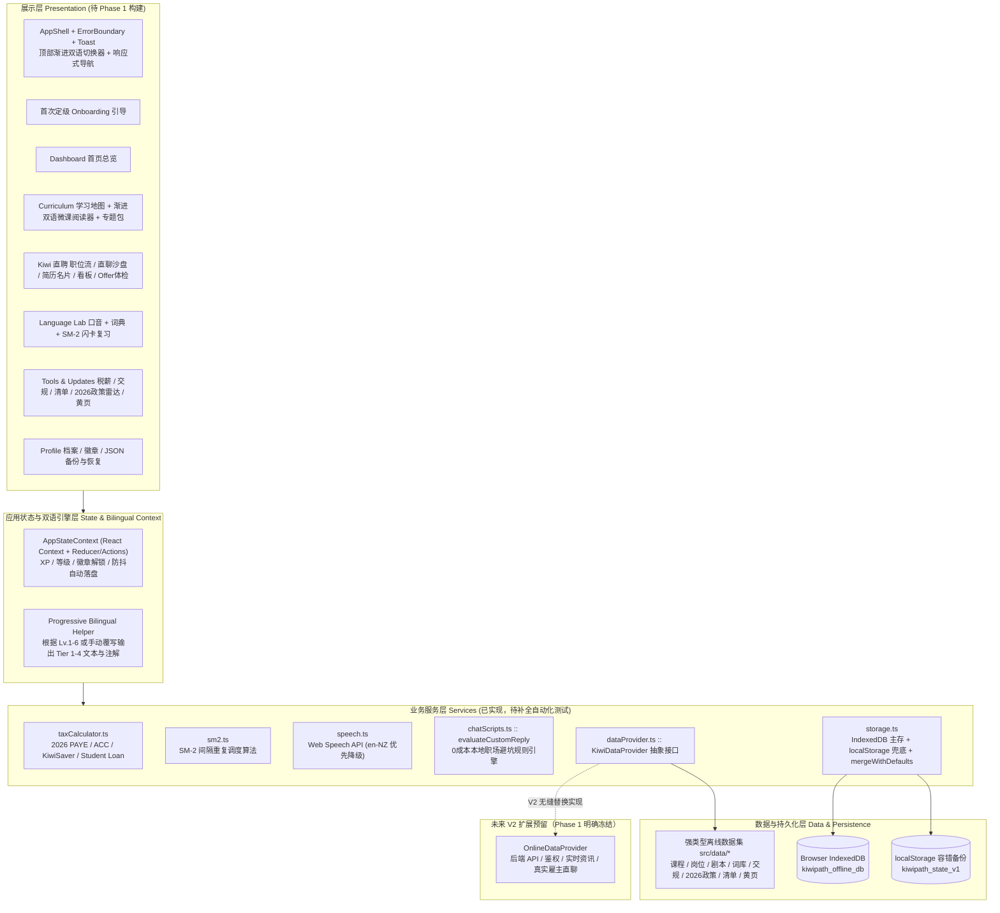

# KiwiPath（新西兰人成长学院）— 技术架构与防过时复核真相源 (`ARCHITECTURE.md`)

> **文档状态：** V2.0（2026-11-25 升级为「单文件可分发离线 HTML + GitHub 公开 JSON 数据库直连同步 + 48 节全量百科架构」）

---

## 0. V2.0 核心分发与云端数据库架构（2026-11-25 经用户审批升级）

- **单文件独立分发（`npm run build:single`）**：通过 `vite.singlefile.config.ts`（IIFE 格式）+ 零依赖脚本 `scripts/build-singlefile.mjs`，将整个前端 + 样式 + 48 节完整离线百科内联为单个 **`KiwiPath-新西兰离线百科.html`**（实测约 `924 KB`，0 外部脚本/样式依赖），发给任何人可直接双击在浏览器 `file://` 打开，免装 Node、免填个人姓名、学习记录仍自动保存在本地浏览器。
- **GitHub 公开 JSON 数据库（`content/`）**：通过 `npm run export:db` 从 `src/data/curriculum/mod1..8Lessons.ts` 导出标准化 `content/manifest.json`、`content/modules/mod-1..8.json` 与 `content/policies.json`。
- **前端直连同步（`src/services/githubSync.ts`）**：默认指向 `https://github.com/lfredwang/KIWIPATH.git`（`https://raw.githubusercontent.com/lfredwang/KIWIPATH/main/content/manifest.json`），支持一键拉取、严格 Schema 校验并缓存至 `IndexedDB`，断网仍可读最新版。

---

## 1. 本机开发环境实测清单（2026-11-24）

| 项目 | 实测版本 / 路径 | 状态与注意事项 |
| :--- | :--- | :--- |
| **操作系统** | macOS 27.0.1 (Build 26A434, Apple Silicon) | 正常 |
| **Node.js** | `v26.13.1` (`/opt/homebrew/bin/node`) | 现代版本，原生支持 `node:test` 与 TypeScript 类型擦除；**注意：** 非登录 shell 默认不含 `/opt/homebrew/bin`，脚本需显式补充 `PATH` |
| **npm** | `11.20.0` (`/opt/homebrew/bin/npm`) | 正常 |
| **Git** | `2.50.1 (Apple Git-155)` | 已在项目根目录独立初始化 `main` 分支 |
| **Python** | `3.9.6`（系统自带） | 仅用于辅助脚本，本项目运行时不依赖 Python |

---

## 2. 已安装前端技术栈核验（`node_modules` 实测版本）

| 组件 | `package.json` 声明 | `node_modules` 实测版本 | 角色与评估 |
| :--- | :--- | :--- | :--- |
| **React / React DOM** | `^19.1.0` | `19.3.1` | 现代主线版本，稳定支持 React 19 特性 |
| **TypeScript** | `^5.8.3` | `5.9.3` | `strict: true`、`ES2022`、`noEmit: true`，强类型保障 |
| **Vite** | `^6.3.5` | `6.4.6` | 极速开发与生产打包 |
| **Tailwind CSS** | `^4.1.8` | `4.3.5` (`@tailwindcss/vite` 4.3.5) | v4 CSS-first `@theme` 主题变量，已配置银蕨绿/塔斯曼蓝/毛利琥珀色板 |
| **vite-plugin-pwa** | `^1.0.0` | `1.3.0` | Workbox 静态资源预缓存，支持离线安装为桌面/手机 PWA |
| **lucide-react** | `^0.511.0` | `0.511.0` | 轻量树摇 SVG 图标库 |

---

## 3. 系统分层架构图



---

## 4. 关键技术盲区实测结论（Stage 2 防拍脑袋验证）

| 实测项 | 实测命令与方法 | 实测结论 | 架构决策 |
| :--- | :--- | :--- | :--- |
| **1. 现有代码类型与构建基线** | `npx tsc -b --noEmit` & `npx vite build` | `tsc` 对现有 17 个文件（4,602 行）**0 报错通过**；但 `vite build` 失败，报错 `Failed to resolve /src/main.tsx`（因为 UI 入口尚未创建） | 确认底层数据与服务层类型健康，Phase 1 Step 2 优先搭通 `src/main.tsx` + `App.tsx` 最小可构建骨架 |
| **2. 自动化测试运行机制** | `node --input-type=module` 直接导入 `taxCalculator.ts` / `sm2.ts` / `dataProvider.ts` | Node `v26.13.1` 原生内置 `node:test` 且支持直接执行 TypeScript；但对无 `.ts` 后缀的相对运行时导入（如 `dataProvider.ts` 导入 `../data/jobs/jobsData`）会报 `ERR_MODULE_NOT_FOUND` | 在 Phase 1 Step 1 中，优先采用零外部依赖的 Node 原生 `node:test` + 轻量 ESM `.ts` 解析钩子（`tests/ts-loader.mjs`，约 15 行）跑通全量业务单测与数据完整性校验；无需急于引入重型测试框架，后续若需组件 DOM 测试再按需评估 `vitest` |
| **3. 离线语音朗读（Web Speech API）** | 代码审计 `src/services/speech.ts` | 已实现 `en-NZ → en-AU → en-GB → en-*` 优雅降级；但不同浏览器首次调用 `getVoices()` 可能返回空数组（需监听 `voiceschanged` 事件） | 在 Profile / Language Lab UI 层监听 `speechSynthesis.onvoiceschanged` 刷新语音列表，且无可用语音时提供友好提示而非报错 |
| **4. 本地持久化与迁移安全** | 代码审计 `src/services/storage.ts` | 采用 `IndexedDB`（`kiwipath_offline_db`, v1）+ `localStorage` 双写兜底，读入时通过 `mergeWithDefaults` 合并默认字段 | 为防未来字段新增或用户导入损坏 JSON 导致崩溃，Phase 1 需补充：① `schemaVersion` 标识；② JSON 导入严格白名单校验器（`validateImportedState` / `validatePolicyPatch`）；③ 覆盖前人工二次确认弹窗 |
| **5. 数据集交叉引用完整性** | Python 脚本遍历校验 `src/data/*` | 8 节旗舰课全部有效映射至 `mod-1`..`mod-8`（0 悬空引用）；12 个岗位全部有效映射至 5 套 `chatScripts`（0 悬空引用） | 将该交叉引用校验固化进自动化测试套件，防止后续扩容内容时出现死链或 ID 拼写错误 |

---

## 5. 目录结构规划

```text
<project-root>/
├── AGENT_RULES.md               # AI 治理宪法
├── PRD.md                       # 产品需求真相源
├── ARCHITECTURE.md              # 技术架构与复核真相源（本文件）
├── ROADMAP.md                   # 宏观三阶段路线图与验收标准
├── TASKS.md                     # 当前迭代任务清单与冻结项
├── PROJECT_CONTEXT.md           # 长期上下文与决策档案
├── SESSION_HANDOVER.md          # 跨会话交接日志
├── AI_DEV_WORKFLOW_PLAYBOOK.md  # 通用工程 SOP 参考手册
├── .gitignore / .env.example    # 安全与环境配置模板
├── docs/PRD_AND_CURRICULUM.md   # 初始完整课程设计原稿（归档参考）
├── scripts/                     # （Phase 1 Step 6）一键启动与校验脚本
├── tests/                       # （Phase 1 Step 1）自动化单元测试与数据完整性校验
└── src/
    ├── main.tsx                 # （Phase 1 Step 2）React 挂载入口
    ├── App.tsx                  # （Phase 1 Step 2）根壳、ErrorBoundary、路由视图切换
    ├── context/                 # （Phase 1 Step 2）AppStateContext + Bilingual 工具
    ├── components/              # （Phase 1 Step 2–5）共享组件（Navbar, BilingualText, ErrorBoundary, Toast, Modal）
    ├── pages/                   # （Phase 1 Step 2–5）6 大一级视图 + Onboarding
    ├── services/                # ✅ 已有 5 个核心服务（tax, sm2, speech, storage, dataProvider）
    ├── data/                    # ✅ 已有 10 个强类型离线数据集 + gamification
    └── types/                   # ✅ 已有完整类型定义 index.ts
```

---

## 6. 依赖与环境安装清单二分法（严格防过度膨胀）

### ① 本机已有 / 已安装（无需重装）
- Node.js `v26.13.1`、npm `11.20.0`、Git `2.50.1`
- `react` 19.3.1、`react-dom` 19.3.1、`typescript` 5.9.3、`vite` 6.4.6、`tailwindcss` 4.3.5、`@tailwindcss/vite` 4.3.5、`vite-plugin-pwa` 1.3.0、`lucide-react` 0.511.0

### ② Phase 1 当前阶段按需新增（极简原则）
- **0 个必需第三方运行依赖！** 全部测试使用 Node v26 原生 `node:test`，全部状态管理使用 React 19 原生 `Context + hooks`，全部动画/样式使用 Tailwind CSS v4。
- 若 Phase 1 后期确实需要浏览器级组件测试，再经用户批准后按需添加 `vitest` / `@testing-library/react`。

### ③ 明确未来才装（Phase 1 严禁安装）
- ❌ 任何后端框架（Express / Fastify / FastAPI / Supabase / Firebase）
- ❌ 任何重型状态管理库（Redux Toolkit / Zustand / MobX）
- ❌ 任何路由重包（若 6 大主视图用受控状态 + URL Hash 足够轻便且完全兼容 PWA 离线，无需引入复杂路由框架）
- ❌ 任何付费 AI SDK（OpenAI / Gemini SDK 等，V1 严格坚持 0-Cost 本地规则引擎）
- ❌ 任何 PDF 重型生成库（如 `jspdf` / `html2canvas`，V1 使用原生 `@media print` 零体积高质量打印导出 PDF）
