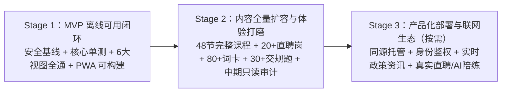

# KiwiPath（新西兰人成长学院）— 宏观演进路线图与验收标准 (`ROADMAP.md`)

> **文档定位：** 将宏大愿景收敛为清晰的 **3 个演进阶段**，并为每个交付模块定义**可执行的验收标准**（具体到操作步骤、刷新持久化与验证命令）。

---

## 阶段总览

---

## Stage 1（MVP — 离线优先全功能可运行闭环）`[当前主战场]`

**阶段目标：** 在零后端、零付费 API 前提下，交付一个**打开即用、断网可用、数据不丢、所有核心模块均真实可交互且通过四层验证**的 KiwiPath Web 应用。

### Stage 1 模块级可执行验收标准

| 模块 | 交付范围 | 可执行验收标准（Acceptance Criteria） |
| :--- | :--- | :--- |
| **M0. 工程地基与测试** | Git 仓、`.gitignore`、`.env.example`、7 份 Playbook 文档、Node 原生自动化测试套件 | 1. `git check-ignore -v .env data/app.db` 命中规则； 2. `npm test` 全部通过（覆盖 2026 税薪算法、SM-2 调度、直聘避坑规则、存储合并与 JSON 校验、全量数据集引用完整性），0 失败。 |
| **M1. 应用骨架、定级与双语引擎** | `main.tsx`、`App.tsx`、全局 `ErrorBoundary`、Toast 反馈、首次定级 Onboarding、顶部 `Tier 1–4` 渐进双语切换 | 1. `npm run build`（`tsc -b && vite build`）0 报错生成 `dist/` 及 PWA Service Worker； 2. 首次打开弹出定级向导，填写称呼/城市/阶段并提交后，刷新页面不再重复弹出，顶部正确显示所选城市与等级； 3. 切换 `Tier 1 / 2 / 3 / 4`，界面双语展示实时变化且刷新后保留偏好。 |
| **M2. 首页总览（Dashboard）** | 个人等级与 XP 进度条、今日 3 分钟挑战、推荐下一节微课、最新 2026 政策提醒、快捷入口 | 1. 完成今日挑战后 XP 即时增加、按钮变为“今日已完成”、解锁 `daily-challenger` 徽章； 2. 刷新浏览器后 XP、连击天数与已完成状态保持不丢失。 |
| **M3. 学习地图（Curriculum）** | 8 大模块导航、8 节旗舰微课完整交互阅读器（卡片+术语发声+情景测验）、5 城区域包 & 2026 签证通道包 | 1. 点开任意一节旗舰课（如 `l-05` GP/ACC 或 `l-08` 2026 租房新政），能逐卡阅读、点击术语触发朗读、完成情景答题并看到双语反馈； 2. 点击完成课程后获得 XP、模块进度条更新，刷新页面后已完成状态持久化； 3. 切换到「区域城市包」「签证通道包」可完整浏览 5 城与 4 条签证路径。 |
| **M4. 「Kiwi 直聘」（Jobs & Chat）** | 12 岗位多维筛选、BOSS 多轮直聊沙盘（预设选项+自由输入教练点评+三维评分+一键发简历名片）、NZ 简历合规生成器（含打印 PDF）、求职看板、Offer 体检器 | 1. 顶部清晰标注「离线仿真求职沙盘」；筛选城市/签证标签可实时过滤岗位； 2. 点击「立即沟通」进入聊天室，发送简历名片并完成多轮对话（含一次故意踩雷的自由输入，验证教练拦截提示），最终可触发面试邀约/模拟 Offer； 3. 在简历页勾选“添加照片/年龄”时弹出新西兰《人权法》红线警示； 4. 在 Offer 体检器输入年薪并切换 Total Rem / On Top，税后到手差额实时变化；刷新页面后聊天记录与看板状态完整保留。 |
| **M5. 语言实验室（Language Lab）** | 44 词条分类检索 + 12 毛利地名正音 + Web Speech 朗读 + SM-2 每日闪卡复习队列 | 1. 按分类筛选与搜索词条正常，点击朗读调用 `speechSynthesis` 不报错； 2. 在闪卡复习模式点击 `Again/Hard/Good/Easy` 后，卡片进入下一张并更新到期时间，刷新后复习记录保留。 |
| **M6. 工具箱与新政雷达（Tools）** | 2026 税薪计算器、18 题 Road Code 刷题与错题本、7 组 35 项 Checklist（支持自定义新增）、12 条 2025–2026 政策雷达（含安全 JSON 补丁导入）、16 条本地 App 与紧急黄页 | 1. 税薪计算器输入 `$100,000` 年薪，PAYE 显示 `$22,877.50`（与单测一致）； 2. 交规答错自动进错题本、答对可移出； 3. Checklist 勾选与自定义新增条目刷新后保留； 4. 黄页支持一键复制紧急号码并弹 Toast 提示； 5. 政策雷达导入非法 JSON 时拦截报错，导入合法 JSON 补丁后合并显示并持久化。 |
| **M7. 个人档案、备份恢复与一键启动** | 画像编辑、语音选择、徽章墙、JSON 备份导出/导入（带校验与二次确认）、重置数据二次确认、`scripts/start.sh` 一键启动脚本 | 1. 导出 JSON 后清空或修改状态，再导入该 JSON 弹出二次确认框，确认后原进度与聊天记录 100% 恢复； 2. 运行 `scripts/start.sh` 可自动拉起开发/预览服务并优雅退出。 |

---

## Stage 2（内容全量扩容、体验打磨与中期审计）`[Planned]`

**前置条件：** Stage 1 全部验收通过并经过用户一轮真实使用反馈。

1. **核心内容扩充：**
   - 微课从 8 节旗舰课分批扩充至 16 节（MVP+）→ 48 节完整大纲；
   - 直聘岗位从 12 个扩充至 25–50 个（补充更多地区与细分岗位剧本）；
   - 语言词库从 44 条扩充至 80–120 条；
   - Road Code 题库从 18 题扩充至 50+ 题（含更多路标图示与情景题）。
2. **实机打磨与性能优化：**
   - 路由级代码分割懒加载（`React.lazy`），压低首屏 JS 体积；
   - 完善 PWA 图标资源、离线更新提示横幅与手机端手势体验。
3. **中期只读系统级审计（Playbook 阶段 7）：**
   - 暂停新功能，产出 `AUDIT_AND_ROADMAP.md`，逐项核验代码真相矩阵、备份恢复演练、隐私边界与打包体积。

---

## Stage 3（产品化演进与联网生态 — 按需开启）`[Frozen / Future]`

**前置条件：** Stage 2 稳定运行且用户明确决定投入后端/云部署与运维成本。

1. **实时资讯与政策同步：** 通过 `OnlineDataProvider` 接入 RNZ / GeoNet / Immigration NZ 官方公告源（遵守成本控制与缓存策略）。
2. **可选 AI 口语/面试陪练：** 抽象 `AIProvider` 接口，密钥走后端代理、严禁前端暴露密钥、强制记录 Token 成本与隐私硬隔离。
3. **跨设备同步与真实招聘扩展：** 先完成账号鉴权（密码哈希 + HttpOnly Session）与隐私合规设计，再考虑跨设备云同步或真实雇主入驻。
