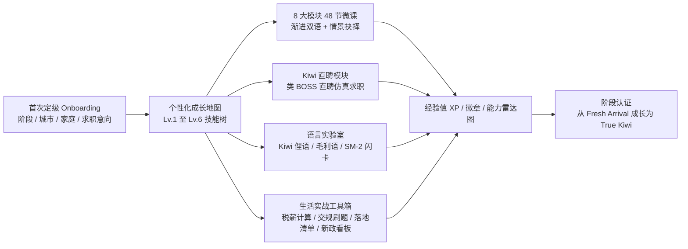
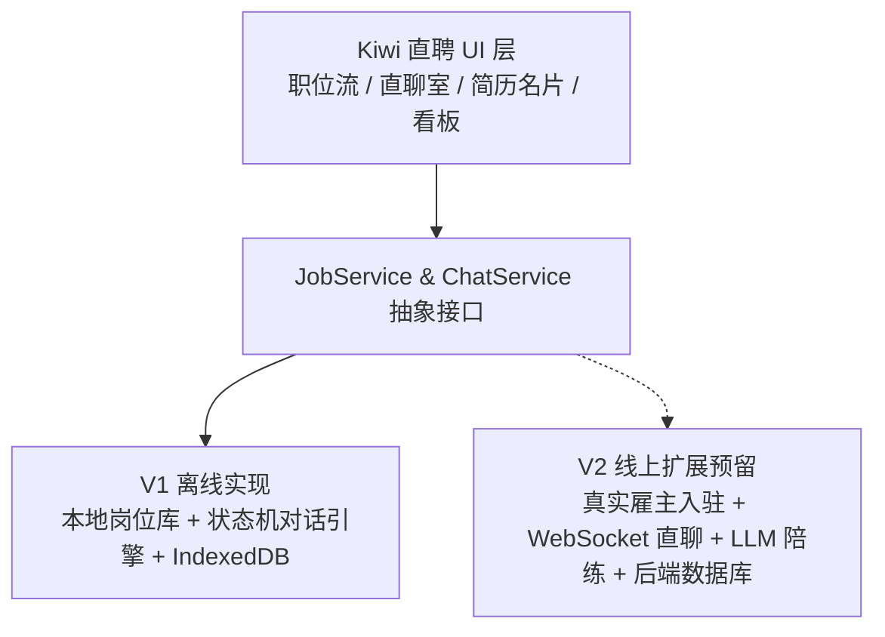

# KiwiPath（新西兰人成长学院）— 完整产品设计方案与课程大纲

> [!NOTE]
> **产品定位**：面向移民的 **离线优先（Offline-First）+ 渐进双语（Progressive Bilingual）+ 学习与求职一体化** Web 应用（支持桌面与手机端，PWA 可断网使用）。  
> **信息基线**：已核验至 **2026 年 11 月** 新西兰最新法规与社会动态，并采用数据解耦架构，预留未来接入联网实时资讯与真实招聘后端的接口。

---

## 一、深度补漏审计：我们此前漏掉了哪些关键内容？

在重新审视新移民从“落地”到“成为真正 Kiwi”的全生命周期后，除了您指出的 **找工作与类 BOSS 直聘功能** 外，以下 **7 大高频刚需与易踩坑领域** 是绝大多数资料容易忽略、但实际生活极其致命的板块，已全部纳入本方案：

| 序号 | 补漏领域 | 核心痛点与必学内容 |
| :--- | :--- | :--- |
| **1** | **求职就业、职业注册与自雇创业** | 不止是“职场文化”，还涵盖全套找工作实战（NZ 简历、Cover Letter、LinkedIn、隐藏招聘市场、STAR 面试、Reference Check、审合同避坑）、**职业持证注册制度**（NZQA 学历认证、水工/电工/护士/教师/工程师持证红线）、**类 BOSS 直聘直聊模块**，以及自雇/Contractor/小生意（NZBN、GST \$60,000 门槛、2026 新 Contractor 判定标准）。 |
| **2** | **法律常识、维权与防诈骗** | **《消费者保障法》（CGA）** 维权尚方宝剑、**Disputes Tribunal（小额仲裁庭）** 免律师维权、**JP（太平绅士）** 免费公证、**CAB（公民咨询局）** 与 Community Law 免费法律援助、111/105/1737/Healthline 分工、反诈骗（钓鱼短信、私人换汇骗局、假租房/卖工作骗局）。 |
| **3** | **征信、全险种与跨境税务** | 三大征信机构（Centrix/Equifax/Illion）、车险（非强制但撞豪车风险极大）/房屋/家财/商业医疗险（既往症坑）、**新移民 4 年海外收入免税期（Transitional Tax Residency）**、FIF 税务新规、合规跨境资金与反洗钱（AML）证明。 |
| **4** | **全生命周期生活事件** | **成人看牙自费巨坑**（18岁以下免费，成人公立不包）、**LMC 助产士免费生育体系**与 Plunket 育儿跟踪、**移民心理适应与孤独感管理**、**养宠法规**（Council 注册、芯片、海滩限制、宠物押金新政）、遗嘱（Will）与持久授权书（EPA）。 |
| **5** | **新西兰区域差异指南** | 奥克兰 / 惠灵顿 / 基督城 / 汉密尔顿 / 陶朗加 / 皇后镇 / 但尼丁的产业就业、房租水费（如奥克兰单独收水费 vs 其他城市含在地税）、公交卡（AT HOP / Snapper / Metrocard）、气候与地方建省日假期（Anniversary Day）差异。 |
| **6** | **本地数字生态与工具黄页** | 新西兰本地人日常必备 App 生态：Gaspy（油价）、Grocer（超市比价）、Trade Me、MetService、GeoNet、Plan My Walk（户外安全）、ManageMyHealth、Neighbourly（社区邻里）等。 |
| **7** | **签证升级到公民完整闭环** | 工签（AEWV）→ 居留签（SMC / 绿名单 / 配偶）→ **永久回头签（PRV，新西兰独有、永不过期无移民监）** → 公民入籍（5年居住与宣誓）→ 持 NZ 护照赴澳工作生活权益与边界；以及父母团聚最新排队机制。 |

---

## 二、2025–2026 最新政策与社会基线（离线内置核验版）

为满足“最新信息”要求，离线版 V1 将内置**截至 2026 年 11 月核验**的真实数据，每条知识卡片均标注 `最后核验日期` 与 `官方出处`，并设计「政策更新包导入 / 未来在线同步」机制：

| 领域 | 2025–2026 关键最新变化（内置基线） |
| :--- | :--- |
| **最低工资与税阶** | 2026 年 4 月 1 日起成人最低工资涨至 **NZ\$23.95/小时**；个税五档税阶为 10.5%（\$0–\$15.6k）/ 17.5%（至 \$53.5k）/ 30%（至 \$78.1k）/ 33%（至 \$180k）/ 39%（\$180k 以上）。 |
| **KiwiSaver 退休金** | 2026 年 4 月 1 日起默认雇员与最低雇主缴存比例从 3% 升至 **3.5%**（2028 年 4 月升至 4%，可申请临时降回 3%）；政府年度补贴减半至最高 **NZ\$260.72**，且年收入超 **\$180,000** 不再享受政府补贴；16–17 岁纳入。 |
| **签证与技术移民** | AEWV 取消全行业强制中位数工资限制（改按市场价+法定底薪），但 2026 年 3 月官方中位数参考标准升至 **NZ\$35.00/小时**（仍用于担保配偶/子女及居留通道）；**2026 年 8 月 24 日** SMC 大改新增 **Skilled Work Experience** 与 **Trades & Technician** 两条通道；**2027 年 3 月 8 日**绿名单 Tier 2 将调整 17 个职业。 |
| **雇佣法重大改革** | 2026 年 2 月实施《雇佣关系修正案》：明确 **Contractor 5 项法定判定测试**、年薪 **\$200,000+** 限制无理解雇申诉、取消前 30 天强制集体协议；**90 天试用期**适用于全规模企业但必须**入职前书面签署**；2025 年 3 月起故意克扣工资入刑；2026 年 8 月通过《Employment Leave Act 2026》（2028 年 8 月生效，改按小时累积年病假 + 临时工 12.5% LCP）。 |
| **租房新规** | 2025 年 1 月 30 日恢复**房东 90 天无理由解约**、特定理由（自住/卖房）缩短为 **42 天**、租客解约缩短为 **21 天**；2025 年 12 月 1 日实施**宠物押金（Pet Bond，最高 2 周租金）**，禁止无合理理由一刀切禁宠。 |
| **交通与驾照新规** | **2026 年 10 月 1 日**新交规生效：超车骑行者/行人须留 **1.5 米距离**、60km/h 及以下道路须**让行出站公交车**、12 岁以下儿童可在人行道骑车、电动滑板车可用自行车道；**2026 年 11 月 1 日**起新入境海外驾照有效期回正为 **12 个月**；电车 RUC 公里税（纯电 **\$76/1000km**，插混 **\$38/1000km**）。 |
| **医疗、维权与公民** | 处方费常规 **\$5/项**，2026 年 2 月起稳定慢性病可开具最长 **12 个月处方**；2026 年 1 月 24 日起 **Disputes Tribunal 仲裁上限翻倍至 \$60,000**；2026 年 5 月跟踪骚扰正式单独立罪；2026 年 11 月 7 日大选成为讲解 MMP 选举制度的鲜活案例。 |

---

## 三、产品整体架构与用户成长闭环

---

## 四、渐进双语引擎设计（Progressive Bilingualism）

不同于简单的“中/英切换”，系统将语言浸润绑定到用户的学习进度，同时随时保留一键辅助（避免卡壳挫败感）：

| 语言阶段 | 对应用户等级 | 界面与内容配比 | 交互机制 |
| :--- | :--- | :--- | :--- |
| **Tier 1：生存护航** | Lv.1–Lv.2（行前 / 落地初） | **80% 中文 + 20% 核心原词** | 中文清晰讲透逻辑，所有高频专有名词（`IRD`, `GP`, `ACC`, `Bond`, `WOF`, `Kia ora`）高亮显示，点击发声并弹出词卡。 |
| **Tier 2：双语过渡** | Lv.3（独立生活 / 求职） | **50% 中文 + 50% 英文** | 真实对话、表单字段、职位描述、邮件范文、交规题干使用英文，关键解析与避坑提示用中文。 |
| **Tier 3：语境进阶** | Lv.4–Lv.5（职场 / 社交 / 文化） | **25% 中文 + 75% 英文 + Te Reo** | 正文、直聘对话、新闻案例全英文呈现；文化潜台词与长难句默认折叠中文注解（点击/悬停即显）。 |
| **Tier 4：True Kiwi 沉浸** | Lv.6（文化通 / 入籍） | **95% 英文 + Te Reo Māori** | 模拟真实新西兰全英文与双文化环境，仅保留专业术语悬浮词典。 |

- **手动覆写开关**：顶部常驻语言模式切换器（`跟随等级自动进阶` / `强制 Tier 1–4`），照顾不同英语基础的移民。
- **离线语音朗读**：调用浏览器内置 `Web Speech API`（优先匹配 `en-NZ` 语音包，自动降级 `en-AU`/`en-GB`），配人工标注的 **Kiwi 元音对照表**（如 `fish & chips` → *fush & chups*，`six` → *sux*）和 **毛利语拼读规则**（5 纯元音、`wh` 发 `f`、长音符 macron）。

---

## 五、核心特色模块：「Kiwi 直聘」—— 类 BOSS 直聘求职系统设计

把国内用户熟悉的 **BOSS 直聘「刷岗位 → 看亮点 → 发名片 → 直接开聊」** 的高效体验，本土化改造成**真正贴合新西兰求职逻辑的离线仿真求职系统（并预留线上化架构）**。

### 5.1 离线版 V1 核心功能（完整可交互）

1. **职位广场（Job Feed & 智能匹配）**
   - 内置 **30–50 个高仿真新西兰代表性岗位**，覆盖主流移民行业：IT/软件工程、建筑/Trades（木工/电工/项目管理）、医疗护理、幼教/中小学教师、财会/商业分析、市场/电商、物流供应链、酒店餐饮管理、农林工程。
   - **新西兰专属筛选标签**：
     - 城市：Auckland / Wellington / Christchurch / Hamilton / Tauranga / Queenstown / Remote
     - 签证友好度：`AEWV 认证雇主` / `绿名单 Tier 1 直通` / `绿名单 Tier 2` / `Open Work Visa / PR`
     - 雇佣类型：Permanent（全职）/ Fixed-term / Contractor（时薪）
     - 薪资透明度：显示 NZD 年薪或时薪区间、是否标明 `+ KiwiSaver (3.5%)`
2. **「立即沟通」BOSS 直聊沙盘（Interactive Direct Chat）**
   - 每个岗位配备真实感 **Hiring Manager / Recruiter** 档案（姓名、职位、公司规模、响应风格，如直爽的工地经理 vs 严谨的科技公司 Tech Lead vs 专业猎头）。
   - **类 BOSS 直聘交互流**：
     - 进入聊天室，可直接发送预设的**地道 Kiwi 开场白**（分 Tier 1–4 双语辅助）或自行编辑回复，一键投递「我的 NZ 简历名片」。
     - **离线多轮仿真对话引擎（状态机 + 意图/关键词评分）**：招聘方按新西兰真实初筛流程开展 4–6 轮对话：
       1. 签证与工作权利确认（Work Rights）
       2. 相关经验与可迁移技能（无本地经验怎么破局）
       3. 行为面试微问答（STAR 法则）
       4. 薪资预期与入职时间（Notice Period & Salary Expectation）
       5. 团队氛围/文化匹配（Culture Fit / Banter）
     - **侧边「Kiwi 求职教练」实时点评**：
       - 每一步对你的表达打分（专业度 / 地道度 / 文化契合度），指出雷区（如主动提年龄/婚姻、过度自夸触碰 Tall Poppy、薪资报太死、忽略签证说明）并给出 **更地道的 Kiwi 替代表达**。
     - 沟通达标后触发 **「约面试」→「收到模拟 Offer」** 完整闭环。
3. **NZ 简历名片生成器（NZ CV & Cover Letter Builder）**
   - 引导用户输入背景，自动套用新西兰标准格式（**自动拦截照片、年龄、性别、婚姻、国籍等国内简历常见雷区**），强调“成就量化 + 软技能 + 签证状态 + Referees available on request”。
   - 生成可视化简历名片（用于直聊一键投递）并支持**导出打印 PDF / 备份 JSON**。
4. **Offer 体检器 & 求职看板（Pipeline + Contract Checker）**
   - **看板**：管理 `已收藏` / `沟通中` / `待面试` / `已拿 Offer` 的全部岗位。
   - **Offer 合同体检器**：输入年薪/时薪与合同条款，自动计算 **2026 税后周薪/双周薪/月薪**，核查 `KiwiSaver 是 Total Remuneration（含在总包内）还是 On Top（额外给）`、`90天试用期是否在入职前签字`、`是否高于最低工资 \$23.95 或中位数 \$35.00`。
5. **真实求职外部雷达 & 防坑红线**
   - 汇总真实求职渠道（Seek、Trade Me Jobs、LinkedIn、政府岗位 jobs.govt.nz、INZ 认证雇主列表查询、Coffee Catch-up 约咖啡人脉话术），并设 **“防卖工作 / 假雇主担保骗局”红线检测表**。

### 5.2 未来在线版 V2 预留设计

---

## 六、完整课程大纲：8 大模块 × 48 节核心课 + 2 个专题包

> 每节课统一采用 **「5–8 分钟卡片微课 + 渐进双语切换 + 真实情景抉择（3–5 题） + 行动清单 / 词卡沉淀」** 结构。

### 模块 1：落地第 1–30 天：生存基建与官方系统（Lv.1 | 6 课）
1. **入境第一关：海关检疫与生物安全（Biosecurity）** — 申报红线、食品/药品/户外鞋靴检查、电子入境卡（NZTD）
2. **数字身份基建：RealMe、IRD 税号与本地手机号** — 办税号流程、三大运营商（Spark/One NZ/2degrees）与低价套餐对比
3. **银行与消费习惯：开户、EFTPOS 与 PayWave** — 四大行+Kiwibank、无现金文化、PayWave 附加费（Surcharge）潜规则、换汇避坑
4. **政务与免费求助网：CAB、JP 太平绅士与政府热线** — 免费公证签字去哪找、Citizens Advice Bureau、111 vs 105 vs Healthline
5. **医疗体系初识：GP 注册、ACC 全民意外险与急诊分流** — 什么时候去 GP / After-hours / ED，ACC“无过错赔付”神奇机制
6. **落地 30 天通关实战** — 情景演练 + 个人落地待办清单生成

### 模块 2：安家居住：租房、买房与 Kiwi 居家文化（Lv.1–Lv.3 | 6 课）
7. **新西兰找房与租房全流程** — Trade Me / Flatting 合租 vs 整租、看房礼仪、准备租房推荐人（Rental Reference）
8. **租房法规与 2025–2026 新政避坑** — Bond 押金监管（最多 4 周）、Healthy Homes 保暖防潮标准、90 天无理由/42 天/21 天解约规则、**2 周宠物押金（Pet Bond）新政**
9. **水电网与生活账单优化** — 电力/燃气/光纤比价（Powerswitch）、冬季取暖除湿策略（Heat Pump / 除湿机 / 通风）、各市水费差异
10. **垃圾分类、二手循环与 DIY 文化** — 红黄绿垃圾桶、Op Shop 二手淘货、Trade Me 买卖防骗、Bunnings / Mitre 10 逛五金店与周末香肠义卖
11. **买房入门：从看房到成交（进阶）** — Auction 拍卖 / Tender / Deadline Sale / Negotiation 区别、LIM Report 与 Building Inspection、Freehold vs Cross-lease vs Unit Title（Body Corp）
12. **房屋持有与邻里边界** — 地税（Rates）、房屋/家财险、修剪树篱与噪音法规、木结构房防漏与维护常识

### 模块 3：出行与驾照：左行驾驶与 2026 新交规（Lv.1–Lv.2 | 5 课）
13. **海外驾照转换与 12 个月新规** — 2026 年 11 月起 12 个月有效期规则、免考国家 vs 非免考（理论+路考流程）、翻译件要求
14. **NZ Road Code 高频易错点精讲** — 左行习惯、Give Way 让路大原则（右转/左转/T字口）、环岛（Roundabout）打灯规则、Flush Median 中央缓冲带、单车道桥与 Passing Lane
15. **2026 年 10 月最新交规专题** — 超车骑行者/行人 **1.5 米安全距离**、60km/h 以下**让行出站公交车**、儿童人行道骑车、学校 30km/h 可变限速区
16. **买车、养车与车险必懂** — 车商买车（CGA 保护）vs 私人买车（检车查抵押 CarJam）、WOF 车检、Rego 路税、**电车/插混/柴油车 RUC 公里税**、全险 vs 第三方险
17. **公共交通与城际出行** — 各城公交卡（AT HOP / Snapper / Metrocard）、火车/渡轮、国内航班与自驾安全（窄路/砂石路/疲劳驾驶）

### 模块 4：求职通关、职场文化与自雇创业（Lv.2–Lv.4 | 7 课，联动「Kiwi 直聘」）
18. **新西兰就业市场与职业注册制度** — 热门紧缺行业、NZQA 学历评估（IQA）、持证上岗行业红线（水电建筑、医疗、教育、工程）
19. **写一份打动 Kiwi 老板的 CV 与 Cover Letter** — 规避照片/年龄雷区、量化成果写法、针对性改写技巧（联动简历名片生成器）
20. **破局“没有本地经验”：全渠道求职与人脉拓展** — Seek / Trade Me Jobs / LinkedIn、隐藏职位与约咖啡（Coffee Catch-up）、猎头合作、防招聘诈骗
21. **面试实战与 Reference Check** — 高频 Behavioural 行为题（STAR 结构）、文化匹配（Culture Fit）考察点、推荐人准备与背调流程（联动「Kiwi 直聘」模拟开聊）
22. **谈薪与看懂雇佣合同（2026 新雇佣法）** — 薪资调研、IEA 个人协议、**90 天试用期生效前提**、KiwiSaver（Total Rem vs On Top）、2026 雇佣法与 2028 新假期法解读、欠薪入刑维权
23. **地道新西兰职场生存法则** — 扁平化管理、**Tall Poppy Syndrome（忌高调炫耀）**、Morning Tea 文化、Work-life balance、如何优雅说“不”与请病假/年假
24. **自雇、Contractor 与小生意起步** — Employee vs Contractor（2026 五项法定判定测试）、Sole Trader vs 注册公司、NZBN、GST（\$60k 门槛）、税务抵扣与常用财务工具

### 模块 5：金钱、税务、保险与法律维权（Lv.2–Lv.4 | 6 课）
25. **看懂工资单与个税体系（PAYE & IRD）** — 2026 五档税阶、ACC 征费、副业税码（Secondary Tax Code）、年度退税/补税（MyIRD）
26. **KiwiSaver 深度攻略（2026 新政版）** — **3.5% 缴存比例**、政府年度补贴新规（\$260.72 与 \$180k 上限）、基金风险等级选择（Conservative / Balanced / Growth）、首套房提取与退休规划
27. **信用评分与家庭保险配置** — 三大征信机构维护、医疗险（既往症规则）、寿险/收入保障险、买房贷款（Mortgage）基础与利率锁定策略
28. **新移民跨境金融与税务合规** — **4 年海外收入免税期**、FIF 海外投资税新规、中新税务协定、合规换汇与 AML 资金来源证明
29. **消费维权与小额仲裁实战** — 《消费者保障法》（CGA）退换修话术、Fair Trading Act、**Disputes Tribunal（上限已升至 \$60,000）** 免律师申诉流程
30. **防诈骗、警务与法律安全常识** — 新西兰高发骗局拆解、网购与租房防骗、2026 反跟踪骚扰法、家暴与社区安全支持资源

### 模块 6：语言通关：Kiwi 英语、口音与日常毛利语（Lv.1–Lv.5 | 6 课，联动语言实验室）
31. **听懂 Kiwi 口音：元音大漂移训练** — *e/i/a* 独特发音规律、句尾上扬语调（High Rising Terminal）、高频连读弱读
32. **日常高频 Kiwi 俚语 50 词（生活篇）** — `Sweet as`, `Yeah nah`, `Chur`, `Choice`, `Togs`, `Jandals`, `Chilly bin`, `Dairy`, `Heaps`, `Ta`, `Wop-wops` 等场景化应用
33. **社交与职场高频表达（进阶篇）** — `Touch base`, `Catch up`, `Keen as`, `Flat out`, `She'll be right`, `Good yarns`, 委婉表达与自嘲幽默（Banter）解码
34. **毛利语（Te Reo Māori）发音入门** — 5 个纯元音、重音与长音符（Macron）、`wh` 与 `ng` 正确读法、新西兰常见地名读音纠正（Whangārei, Taupō, Ōtautahi 等）
35. **职场与生活必用毛利语 40 词** — `Kia ora`, `Ngā mihi`, `Whānau`, `Mahi`, `Hui`, `Kai`, `Aroha`, `Mana`, `Ka pai`, `Kōrero` 等在邮件、开会和新闻中的自然用法
36. **Small Talk 破冰实战** — 如何跟邻居、同事、咖啡师自然聊天气、周末、运动与咖啡，打破社交僵局

### 模块 7：医疗、家庭、教育与心理融入（Lv.2–Lv.5 | 6 课）
37. **看病进阶：慢性病、专科转诊、药房与看牙坑** — **2026 年 12 个月处方新政**、公立等待名单 vs 私立专科、**成人牙科自费攻略**、配镜与体检
38. **生育与母婴福利体系** — 选择免费 LMC 助产士、孕期检查、生产选择、Plunket 跟踪、带薪产假与 Best Start / Working for Families 家庭补贴
39. **新西兰教育全景：幼教到高中** — ECE 20 小时补贴、学区（School Zone）、Equity Index（替代旧 Decile）、NCEA / IB / Cambridge 对比、家长沟通与露营/课外运动
40. **社交礼仪与社区融入** — `Bring a plate`、BYO、BBQ 文化、小费习惯、进门脱鞋、如何通过体育俱乐部/志愿服务/Meetup 交到本地朋友
41. **移民心理健康与文化休克应对** — 识别“蜜月期后的孤独低谷”、冬季情绪调节、免费心理援助（1737 / GP 转介）、家庭代际文化磨合
42. **养宠指南与长远规划** — 养狗注册/芯片/海滩禁令、宠物看病与保险、养老金（NZ Super）规则、遗嘱（Will）与持久授权书（EPA）

### 模块 8：历史、双文化、公民政治与自然户外安全（Lv.3–Lv.6 | 6 课）
43. **双文化基石：《怀唐伊条约》与毛利礼仪（Tikanga）** — 条约历史与现代意义、Pōwhiri 欢迎仪式、Marae 禁忌（不坐餐桌、尊重头部、脱鞋等）
44. **国家记忆与重要节日** — Waitangi Day、ANZAC Day（澳新军团日）、**Matariki（毛利新年）**、女性投票权历史、无核立场、新西兰华人历史与多元文化
45. **政治制度与公民投票（MMP 实战）** — 党票与选区票如何工作（结合 **2026 年 11 月大选** 实例）、中央政府 vs 地方议会（Council）选举与公共意见提交（Submission）
46. **新西兰户外生活方式** — Tramping 徒步与 DOC 山屋预订、赶海钓鱼（尺寸/配额/禁捕区）、咖啡文化、橄榄球（All Blacks & Haka）与全民运动
47. **自然灾害与致命环境安全（必修）** — **强紫外线防晒**、海滩**离岸流（Rip Current）**辨识自救、地震（Drop, Cover, Hold）与海啸（Long or Strong, Get Gone）、应急包（Get Ready）、Tiaki Promise 环保承诺
48. **从新移民到 True Kiwi：入籍与跨塔斯曼视野** — 居民签 → **PRV 永久回头签** → 公民申请与宣誓流程、新西兰护照赴澳权益边界、拥抱多元身份认同

### 附设 2 个按需专题包
- **区域城市包（Regional Packs）**：奥克兰 / 惠灵顿 / 基督城 / 汉密尔顿与陶朗加 / 皇后镇与但尼丁（生活成本、主导产业、租房热门区、交通卡、水费/垃圾与地方假期）。
- **签证与团聚专题包（Visa Pathways 2026）**：AEWV 工签条件、2026 年 8 月 SMC 6 分制与两大新通道自测表、2027 年 3 月绿名单过渡提醒、配偶签与父母团聚队列说明。

---

## 七、离线实用工具箱与互动功能清单

除课程与「Kiwi 直聘」外，程序内置 **7 个高频离线工具**（全部零网络依赖、开箱即用）：

1. **2026 税后工资 & KiwiSaver 计算器**：输入年薪或时薪，精准拆解 PAYE 个税、ACC 征费、3.5%（或自定义）KiwiSaver、到手周薪/双周薪/月薪，并对比 Total Rem vs On Top 差额。
2. **NZ Road Code 交规刷题模拟**：精选 50+ 高频易错题（含 2026 年 10 月新规专项），错题自动收录复习。
3. **Kiwi 俚语 & 毛利语闪卡词典（SM-2 间隔重复）**：支持搜索、分类浏览、语音朗读、每日复习队列。
4. **全周期生活 Checklist**：行前 / 第 1 周 / 第 1 月 / 第 1 年 / 买房 / 入籍 / 地震应急包 7 套交互勾选清单，支持自定义增删。
5. **2025–2026 政策变化速查板（Policy Radar）**：按时间线与类别展示最新变更（对比“旧规 vs 新规 + 对你的影响”），并支持**一键导入 JSON 更新包**（无需改代码即可刷新离线政策库）。
6. **新西兰本地 App 与紧急救援黄页**：按政务、省钱、出行、医疗、求职、安全分类，一键复制紧急电话与官网地址。
7. **数据备份与迁移**：学习进度、闪卡掌握度、简历名片、直聘聊天记录与看板全部保存在本地 `IndexedDB`，支持**导出 / 导入 JSON 备份文件**。

---

## 八、Web 应用技术架构与分期实施路线

### 8.1 技术选型（离线优先 Web / PWA）

- **前端框架**：`React 19 + TypeScript + Vite`
- **样式与视觉**：`Tailwind CSS` + 定制新西兰自然色系设计系统（银蕨深绿 `#0F4C3A`、南阿尔卑斯雾白 `#F8FAF9`、塔斯曼海蓝 `#1D6FA5`、毛利雕刻暖陶/琥珀强调色 `#D97706`），响应式布局兼容桌面宽屏与手机竖屏。
- **离线存储与 PWA**：`IndexedDB`（本地状态与记录持久化）+ `vite-plugin-pwa`（Service Worker 缓存，支持手机/电脑“安装到桌面”后完全断网使用）。
- **语音能力**：浏览器原生 `Web Speech API`（优先 `en-NZ` 语音），不依赖付费接口。
- **数据解耦规范**：将课程库（`courses/`）、词卡库（`lexicon/`）、交规题库（`quizzes/`）、直聘岗位与剧本（`jobs/`）、最新政策库（`policies/`）独立为强类型 JSON/TS 数据层，并抽象 `DataProvider` 接口，后续接入真实后端、RSS 资讯或大模型 AI 陪练时无需重写前端界面。

### 8.2 页面信息架构（6 大一级视图）

| 导航板块 | 核心页面内容 |
| :--- | :--- |
| **1. 首页总览（Dashboard）** | 个人 Kiwi 等级与技能雷达、今日 3 分钟挑战、推荐下一节课、最新政策提醒卡片、快捷工具入口 |
| **2. 学习地图（Curriculum）** | 8 大模块 + 2 专题包技能树、进度条、渐进双语微课阅读器、情景抉择与随堂测验 |
| **3. Kiwi 直聘（Jobs & Chat）** | 类 BOSS 直聘职位流 + 多维筛选 + 仿真 BOSS 直聊室（含实时教练点评）+ 简历名片生成器 + 求职看板 + Offer 体检器 |
| **4. 语言实验室（Language Lab）** | Kiwi 口音对比、高频俚语库、毛利语拼读与日常词典、SM-2 每日闪卡复习 |
| **5. 工具与新政（Tools & Updates）** | 税薪计算器、交规刷题、全周期 Checklist、2025–2026 政策雷达、本地 App 与紧急黄页 |
| **6. 个人档案（Profile）** | 定级画像（阶段/城市/签证）、渐进双语等级调节、成就徽章、本地数据导出/导入备份 |

### 8.3 分期开发计划

- **Phase 1（MVP 可运行全功能版 — 下一步优先构建）**：
  - 完成整体视觉设计、定级 Onboarding、渐进双语引擎（Tier 1–4 实时联动）与本地离线持久化。
  - 上线 **8 大模块完整大纲导航** + 精选 **12–16 节核心高互动示范课**（覆盖落地、租房新政、2026 交规、求职面试、税务 KiwiSaver、俚语毛利语、医疗维权、户外安全与毛利文化，确保每个模块都能真实学起来）。
  - 完整交付 **「Kiwi 直聘」模块**：20+ 仿真岗位、完整多轮直聊引擎与实时教练点评、NZ 简历名片生成器、求职看板与 Offer 体检器。
  - 完整交付 **核心离线工具**：2026 税薪计算器、交规刷题器（30+ 题）、80+ 俚语/毛利语 SM-2 闪卡词典、落地与防灾 Checklist、2025–2026 政策雷达、本地 App 黄页。
- **Phase 2（内容全量填充与 PWA 强化）**：
  - 将微课扩充至完整 **48 节** + 5 大城市区域专题包 + 50+ 岗位剧本 + 更丰富的交规与公民题库，完善 PWA 断网安装体验。
- **Phase 3（联网升级，未来按需开启）**：
  - 接入 RNZ/GeoNet/INZ 实时资讯流、LLM 自由口语/面试陪练，以及真实后端把「Kiwi 直聘」升级为真实雇主直聊平台。

---

> [!IMPORTANT]
> **请您审阅确认以下 3 个小问题，确认后我们即可立刻开始搭建 Phase 1 Web 应用：**
> 1. **内容范围**：这份「8 大模块 48 节大纲 + 7 大补漏领域 + Kiwi 直聘」是否还有您特别想补充或删减的主题？（例如更侧重某个行业、带娃教育、还是创业买生意？）
> 2. **「Kiwi 直聘」风格**：离线版做成**高仿真 BOSS 直聘交互（刷岗位 + 一键发 NZ 简历名片 + 多轮模拟开聊 + 教练点评 + Offer 体检）**，并预留真平台接口，是否符合您的预期？
> 3. **应用名称与启动**：暂定名 **KiwiPath（新西兰人成长学院）** 可以吗，或者您心里有更喜欢的名字？确认后我就可以直接在当前工作区初始化项目并开始开发 Phase 1！
